# MAGNETIC AI: Intelligent Magnetic Material Analysis Platform
### Engineering Physics + Machine Learning Capstone Project

MAGNETIC AI is a full-stack, production-quality computational physics and machine learning platform designed to classify, simulate, and analyze magnetic materials. It bridges fundamental quantum mechanical exchange phenomena, continuum micromagnetic domains, and modern supervised machine learning pipelines with rigorous explainability (XAI).

---

## 1. System Architecture

```mermaid
flowchart TD
    subgraph Frontend["React (Vite) + Tailwind CSS + Plotly.js + Three.js"]
        UI_Dash["Home Dashboard"]
        UI_Class["AI Classification Lab"]
        UI_Hyst["Hysteresis Studio (B-H / M-H)"]
        UI_Calc["Magnetic Calculator"]
        UI_Comp["Multi-Material Comparison"]
        UI_Temp["Temperature Lab (Curie-Weiss)"]
        UI_3D["3D Domain Simulator"]
        UI_CSV["CSV Dataset Analyzer"]
        UI_XAI["Explainable AI (TreeSHAP)"]
        UI_Freq["Bertotti Frequency Loss"]
        UI_Learn["Learning Centre & Viva Voce"]
        UI_Rep["ReportLab PDF Exporter"]
    end

    subgraph Backend["FastAPI REST Server (Uvicorn)"]
        API_Router["FastAPI Endpoint Routing"]
        PhysEngine["Physics Engine (SI Standards)"]
        HystEngine["Hysteresis Engine (Tanh & Jiles-Atherton ODE)"]
        TempEngine["Curie-Weiss & Néel Thermal Transition Engine"]
        FreqEngine["Bertotti Statistical Loss Separation Engine"]
        RecommendEngine["Industrial Application Recommender"]
        XAI_Engine["SHAP Feature Attribution Engine"]
        PDF_Engine["ReportLab Technical PDF Generator"]
        DB_Layer["SQLite Persistence Layer (SQLAlchemy)"]
    end

    subgraph ML_Pipeline["Machine Learning Artifacts"]
        Dataset["ml/dataset.csv (350+ SI Samples)"]
        GroupKFold["GroupKFold Validation (k=5)"]
        ModelArtifact["ml/magnetic_model.pkl (Best Classifier Pipeline)"]
        MetricsArtifact["ml/metrics.json (Honest Benchmarks & CM)"]
    end

    UI_Class -->|POST /api/classify| API_Router
    UI_Hyst -->|POST /api/hysteresis| API_Router
    UI_Calc -->|POST /api/properties| API_Router
    UI_Comp -->|POST /api/compare| API_Router
    UI_Temp -->|POST /api/temperature| API_Router
    UI_CSV -->|POST /api/upload| API_Router
    UI_Freq -->|POST /api/frequency| API_Router
    UI_Learn -->|GET /api/learning/quiz| API_Router
    UI_Rep -->|POST /api/report| API_Router

    API_Router --> PhysEngine
    API_Router --> HystEngine
    API_Router --> TempEngine
    API_Router --> FreqEngine
    API_Router --> RecommendEngine
    API_Router --> XAI_Engine
    API_Router --> PDF_Engine
    API_Router --> DB_Layer

    XAI_Engine --> ModelArtifact
    API_Router --> ModelArtifact
```



---

## 2. Directory Structure

```text
magnetic-ai-capstone/
├── backend/
│   ├── app.py                  # FastAPI application entrypoint & OpenAPI docs
│   ├── classifier.py           # Production ML classification service & presets
│   ├── preprocessing.py        # Missing-indicator pipelines & OOD detection
│   ├── physics_engine.py       # SI calculations (χ, B, μ, Hc, Br, loop area)
│   ├── hysteresis.py           # Tanh & Jiles–Atherton ODE numerical solvers
│   ├── temperature.py          # Curie-Weiss, Néel transitions, Langevin diamagnetism
│   ├── frequency.py            # Bertotti theoretical core loss separation (Wh, Pe, Pexc)
│   ├── recommendations.py      # Industrial application suitability scoring
│   ├── explain.py              # TreeSHAP feature attributions & narrative synthesis
│   ├── report.py               # ReportLab PDF generator with embedded B-H charts
│   ├── database.py             # SQLite ORM models & analysis history logging
│   └── requirements.txt        # Backend dependencies specification
├── frontend/
│   ├── src/
│   │   ├── api/client.js       # Axios client for FastAPI endpoints
│   │   ├── components/         # Navbar, Footer, PlotlyChart, Domain3DCanvas
│   │   ├── pages/              # 12 Interactive lab pages & views
│   │   ├── App.jsx             # React Router routing configuration
│   │   ├── index.css           # Tailwind CSS & theme definitions
│   │   └── main.jsx            # React root mount
│   ├── index.html              # HTML shell
│   ├── package.json            # Frontend dependency specifications
│   ├── vite.config.js          # Vite configuration with /api proxy
│   └── tailwind.config.js      # Dark navy & teal design system tokens
├── ml/
│   ├── generate_dataset.py     # Reference seeding + physical simulated variations
│   ├── dataset.csv             # 350+ SI-unit physical material samples
│   ├── train_model.py          # Model cross-validation, selection, and serialization
│   ├── evaluate_model.py       # Holdout verification & pipeline validation
│   ├── magnetic_model.pkl      # Production trained pipeline artifact
│   ├── metrics.json            # Honest cross-validation benchmarks & confusion matrix
│   └── confusion_matrix.png    # High-resolution confusion matrix plot
├── tests/
│   ├── test_physics.py         # Physics formulas, zero crossings, loop area unit tests
│   └── test_api.py             # FastAPI route smoke tests & PDF generation tests
├── reports/                    # Generated technical PDF reports
├── uploads/                    # Temporary uploaded CSV files
├── requirements.txt            # Root Python dependencies
├── package.json                # Root package configuration
├── run_app.bat                 # One-click Windows batch startup script
├── run_app.ps1                 # One-command PowerShell startup script
└── README.md                   # Full system documentation & walkthroughs
```

---

## 3. Physical & Theoretical Foundations (SI Units)

All equations are implemented strictly in standard SI units:

1. **Volume Magnetic Susceptibility ($\chi$):**
   $$\chi = \frac{M}{H} \quad \text{[Dimensionless]}$$
   - Diamagnetic: $\chi < 0$ (e.g. Bismuth $\approx -1.66 \times 10^{-4}$), temperature independent.
   - Paramagnetic: $\chi > 0$ small ($10^{-5}$ to $10^{-3}$), following Curie's Law $\chi = C/T$.

2. **Total Magnetic Flux Density ($B$):**
   $$B = \mu_0 (H + M) \quad \text{[Tesla, T]}$$
   $$\mu_0 = 4\pi \times 10^{-7} \, \text{H/m} \approx 1.256637 \times 10^{-6} \, \text{T}\cdot\text{m/A}$$

3. **Hysteresis Loop Parameters:**
   - **Coercivity ($H_c$):** Reverse field where $B = 0$ (or $M = 0$), evaluated by robust linear interpolation of zero crossings.
   - **Remanence ($B_r$):** Residual induction at applied field $H = 0$.
   - **Saturation ($M_s, B_s$):** Peak spontaneous alignment under infinite excitation.
   - **Loop Area / Energy Loss ($W$):**
     $$W = \oint H \, dB = \frac{1}{2} \left| \sum_{i=1}^{N} (H_i B_{i+1} - H_{i+1} B_i) \right| \quad [\text{J/m}^3 \text{ per cycle}]$$

4. **Hard vs Soft Behavior Classification:**
   - **Soft Magnetic Material:** $H_c < 1.0 \, \text{kA/m}$ ($1,000 \, \text{A/m}$). High permeability, narrow loop, minimal AC loss.
   - **Intermediate / Semi-Hard:** $1.0 \, \text{kA/m} \le H_c \le 10.0 \, \text{kA/m}$.
   - **Hard Magnetic Material (Permanent Magnet):** $H_c > 10.0 \, \text{kA/m}$. High energy product $(BH)_{\max}$.
   - *Metrological note:* Hard vs soft is an engineering behavior class describing coercivity and domain-pinning kinetics, **NOT** a 5th fundamental magnetic ordering category.

5. **Hysteresis Modeling Architectures:**
   - **Phenomenological Extended Tanh:** Separate ascending and descending branches calibrated to match $M_s$, $H_c$, and squareness $S = M_r / M_s$.
   - **Jiles–Atherton Physical Model:** Solves domain wall pinning dynamics:
     $$H_e = H + \alpha M$$
     $$M_{an} = M_s \left( \coth\left(\frac{H_e}{a}\right) - \frac{a}{H_e} \right)$$
     $$\frac{dM_{irr}}{dH} = \frac{M_{an} - M_{irr}}{\delta k - \alpha (M_{an} - M_{irr})}$$
     $$M = c M_{an} + (1 - c) M_{irr}$$

6. **Temperature Dependence:**
   - **Curie–Weiss Law (Paramagnets & Ferro above $T_c$):**
     $$\chi(T) = \frac{C}{T - \theta}$$
   - **Ferro/Ferrimagnetic Spontaneous Magnetization ($T < T_c$):**
     $$M_s(T) = M_{s0} \left( 1 - \frac{T}{T_c} \right)^\beta \quad (\beta \approx 0.35)$$
   - **Antiferromagnetism:** Susceptibility increases up to Néel temperature $T_N$, peaking sharply, then follows Curie–Weiss behavior above $T_N$.

7. **Bertotti Core Loss Separation (Theoretical Model):**
   $$P_{tot}(f) = W_h \cdot f + k_e \cdot f^2 + k_{exc} \cdot f^{1.5} \quad [\text{W/m}^3]$$
   $$P_{mass}(f) = \frac{P_{tot}(f)}{\rho} \quad [\text{W/kg}]$$

---

## 4. Machine Learning & Scientific Integrity

- **Dataset (`ml/dataset.csv`):** 350 samples balanced across 5 classes (70 each of Diamagnetic, Paramagnetic, Ferromagnetic, Antiferromagnetic, Ferrimagnetic).
- **No Data Leakage:** Evaluated with **GroupKFold (k=5)** grouped strictly by base material name.
- **Missing Value Handling:** Legitimate unmeasured features in non-hysteretic classes (e.g. no $H_c$ for diamagnets) are kept as `NaN` and processed through an sklearn Pipeline with `SimpleImputer(strategy='median', add_indicator=True)` and `RobustScaler()`.
- **Benchmarked Models:**
  1. **Gradient Boosting:** Cross-validated Macro-F1: **0.6516**, Accuracy: **77.8%** *(Selected Production Model)*
  2. **Random Forest:** Macro-F1: 0.6135, Accuracy: 69.4%
  3. **Decision Tree:** Macro-F1: 0.6087, Accuracy: 65.9%
  4. **Support Vector Machine (RBF):** Macro-F1: 0.2634, Accuracy: 39.2%
- **Out-of-Distribution (OOD) Protection:** Inputs outside 1st–99th percentile spans or predictions with high entropy ($> 1.45$) or low probability ($< 40\%$) trigger prominent amber warning badges.
- **Explainable AI (TreeSHAP):** Calculates exact Shapley attributions for each input feature and synthesizes an engineering physics narrative explaining the prediction.

---

## 5. Installation and Setup

### Prerequisites
- Python 3.10+ (tested on Python 3.11.8)
- Node.js 18+ and npm

### Step 1: Clone and Setup Python Environment
```bash
# In project root
python -m venv venv
# Windows:
venv\Scripts\activate
# Linux/macOS:
source venv/bin/activate

pip install -r requirements.txt
```

### Step 2: Generate Dataset and Train ML Model
```bash
python ml/generate_dataset.py
python ml/train_model.py
python ml/evaluate_model.py
```

### Step 3: Run Backend & Unit Tests
```bash
# Run 18 comprehensive unit and API smoke tests
python -m pytest ./tests/test_physics.py ./tests/test_api.py -o pythonpath=. -v
```

### Step 4: Setup and Build Frontend
```bash
cd frontend
npm install
npm run build
```

### Step 5: Launch Both Servers (One-Command)
- **Windows (PowerShell):**
  ```powershell
  .\run_app.ps1
  ```
- **Windows (Batch):**
  ```cmd
  run_app.bat
  ```
- **Manual Launch:**
  ```bash
  # Terminal 1: Backend
  python -m uvicorn backend.app:app --host 127.0.0.1 --port 8000 --reload

  # Terminal 2: Frontend
  cd frontend
  npm run dev
  ```
Open **http://localhost:5173** in your browser. OpenAPI Swagger docs are available at **http://127.0.0.1:8000/docs**.

---

## 6. 5-Demo Walkthrough Guide

### Demo 1: AI Material Classification & XAI
1. Navigate to **AI Classification** (`/classify`).
2. Click **Load Preset** and choose **Pure Iron (Soft Ferromagnet)**.
3. Notice that physical SI values are populated ($M_s = 1.71 \times 10^6 \, \text{A/m}$, $H_c = 40.0 \, \text{A/m}$, loop area = $180.0 \, \text{J/m}^3$).
4. Click **Execute ML Classification**.
5. Observe:
   - Predicted class: **FERROMAGNETIC** (Score: >98%).
   - Behavior class: **Soft Magnetic Material** ($H_c < 1.0 \, \text{kA/m}$).
   - TreeSHAP physical attribution highlighting positive drivers ($M_s$, coercivity).
   - Industrial suitability recommendations (high suitability for Transformer Core: 92%).

### Demo 2: Live Hysteresis Studio & ODE Solver
1. Navigate to **Hysteresis Lab** (`/hysteresis`).
2. Toggle between **Empirical Tanh Model** and **Jiles–Atherton Physical ODE**.
3. Adjust sliders for $M_s$, $H_c$, and peak excitation field $H_{\max}$.
4. Click **Play Sweep**: Observe the red marker tracking real-time magnetization $M(t)$ and induction $B(t)$ across ascending and descending loop branches.
5. Inspect the shaded loop area ($W = \oint H dB$) and virgin initial magnetization curve.

### Demo 3: Multi-Material Comparison
1. Navigate to **Comparison** (`/compare`).
2. Select **Pure Soft Iron**, **Neodymium (Nd2Fe14B)**, and **Permalloy**.
3. Inspect the overlaid B-H loops showing the stark contrast between narrow, steep soft iron loops and broad, permanent-magnet NdFeB loops.
4. Review the 5-axis polar radar chart and the industrial suitability matrix.

### Demo 4: 3D Magnetic Domain Microstructure Simulator
1. Navigate to **3D Domains** (`/domains`).
2. Drag with the mouse to freely rotate the 3D dipole lattice in perspective space.
3. Move the **Applied Field Intensity (H)** slider from 0 to $+10 \, \text{kA/m}$:
   - At low field ($H < 4.5 \, \text{kA/m}$): Observe domain wall motion as favorably oriented spins expand.
   - At high field ($H > 4.5 \, \text{kA/m}$): Observe coherent spin rotation toward the external field vector against crystal anisotropy until technical saturation.
4. Toggle **Switch to 2D** to view the planar cross-section fallback mode.

### Demo 5: PDF Technical Characterization Report Generation
1. In either **AI Classification** or **Reports** (`/reports`), click **Download Technical PDF Report**.
2. Open the downloaded PDF in your reader.
3. Verify that the report contains:
   - Publication title banner, sample name, and timestamp.
   - Predicted category and probability spectrum.
   - High-resolution embedded B-H hysteresis curve with annotated $H_c$ and $B_r$.
   - Extracted SI physical properties table.
   - Plain-English XAI Shapley attribution synthesis.
   - Industrial application recommendation scores.
   - Academic disclaimer and governing physics equations.

---

## 7. Known Limitations & Academic Disclaimers

1. **Training Dataset Size:** The classifier is trained on literature reference anchors augmented with physical simulated variations. Model probabilities reflect ensemble statistical scores, not metrologically certified confidence.
2. **Frequency Core Loss Model:** The frequency module implements the theoretical Bertotti separation equation ($P = W_h f + k_e f^2 + k_{exc} f^{1.5}$) and is explicitly labelled as a theoretical model, not experimental data.
3. **Quasi-Static Hysteresis:** The baseline hysteresis simulator models quasi-static major loops and does not incorporate high-frequency skin depth attenuation.
4. **Physical Certification:** Critical industrial electromagnetic components must undergo physical magnetometry testing (VSM, SQUID, vibrating coil, or Epstein frame) before deployment.
